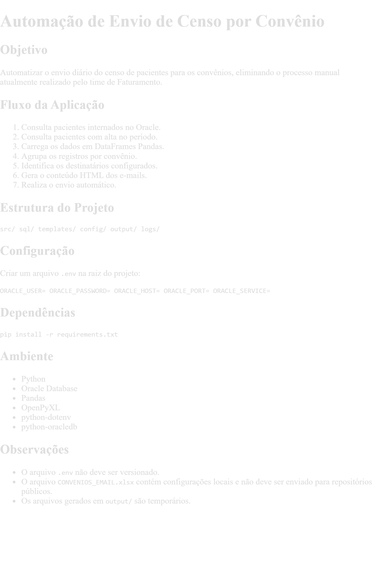

# Reporting & Observability Platform

**Automação de relatórios operacionais com Python, SQL e observabilidade.**

Projeto de portfólio que demonstra a construção de um fluxo de consulta, processamento e distribuição de relatórios, com logs, histórico de execuções, controle de concorrência e detecção de anomalias baseada em regras.

> **Projeto demonstrativo:** o repositório contém código e exemplos sintéticos. Não é uma aplicação pronta para produção, nem depende de dados reais para a demonstração offline.



## O problema e a solução

Rotinas manuais de relatórios podem consumir tempo e dificultar a rastreabilidade. A proposta deste projeto é centralizar a geração e distribuição de relatórios e registrar informações úteis para acompanhar cada execução.

### O que foi implementado

- **Extração e tratamento:** consultas SQL para Oracle e processamento com Python/Pandas.
- **Relatórios:** montagem dinâmica de HTML a partir de templates.
- **Distribuição:** módulo de envio de e-mails via SMTP (Microsoft 365).
- **Confiabilidade:** lock file para evitar execuções simultâneas no mesmo ambiente.
- **Rastreabilidade:** logs e histórico em JSON com data, duração, grupos e status.
- **Tratamento de falhas:** status `SUCESSO`, `SUCESSO_PARCIAL` e `FALHA`.
- **Observabilidade:** detector de anomalias com regras de quantidade, duração e status.
- **Agendamento:** execução compatível com agendadores externos, como Windows Task Scheduler.

## Arquitetura

```text
Banco Oracle / SQL
       |
       v
Python + Pandas ----> Processamento por grupo
       |                       |
       |                       v
       |                Relatório HTML
       |                       |
       |                       v
       |                  SMTP / e-mail
       |
       +----> Logs + histórico JSON
                       |
                       v
                Detector por regras
```

O detector lê o histórico gravado e avalia a última execução. Ele **não usa IA ou machine learning**: as regras são determinísticas e os limites são demonstrativos.

## Demonstração offline — sem Oracle ou e-mail

O modo de demonstração usa **dados totalmente fictícios** e gera um relatório HTML local. É a maneira mais rápida de avaliar o projeto sem configurar infraestrutura externa.

**Requisitos:** Python 3.10+ e pip.

```bash
git clone https://github.com/juliobatistajr/reporting-observability-platform.git
cd reporting-observability-platform
python -m venv .venv
```

Ative o ambiente virtual:

```bash
# Windows (PowerShell)
.venv\Scripts\Activate.ps1

# Linux / macOS
source .venv/bin/activate
```

Instale as dependências e execute:

```bash
pip install -r requirements.txt
python demo.py
```

**Resultado:** `output/demo_report.html`. Abra esse arquivo no navegador. A demonstração não acessa o Oracle e **não envia mensagens**.

### Executar testes locais

```bash
python -m unittest discover -s tests -v
```

### Executar o detector de anomalias

```bash
python -m src.anomaly_detector.detector
```

O detector utiliza o histórico de exemplo em `src/anomaly_detector/historico_execucoes.json`. Regras atuais: menos de **17** grupos processados, duração superior a **120 segundos** ou status de falha/execução parcial. Esses números não são padrões universais.

## Execução integrada (ambiente próprio)

O fluxo principal está em `src/main.py`. Para usá-lo com serviços reais, é necessário:

1. Instância Oracle acessível e consultas SQL compatíveis com o esquema e os campos esperados pelo relatório.
2. Arquivo local `config/CONVENIOS_EMAIL.xlsx` com grupos e parâmetros. Esse arquivo não é disponibilizado no repositório.
3. Credenciais Oracle e SMTP configuradas em `.env`, seguindo `.env.example`.
4. Permissões e infraestrutura SMTP adequadas. O código usa o endpoint SMTP do Microsoft 365.
5. Configuração dos destinatários no fluxo principal antes de qualquer envio real; o endereço presente em `src/main.py` é **apenas um placeholder de desenvolvimento**.

**Atenção:** os SQLs em `sql/` são exemplos genéricos e não estão garantidos como executáveis no seu banco. Os nomes de colunas retornados devem ser adaptados às colunas consumidas em `src/email_builder.py`. Por isso, o fluxo completo não é reproduzível apenas clonando este repositório.

Para conexões Oracle, o driver `python-oracledb` opera em modo thin sem Instant Client. Se seu ambiente exigir thick mode, informe o diretório do cliente pela variável opcional `ORACLE_CLIENT_LIB_DIR`. O esquema Oracle pode ser configurado com `ORACLE_SCHEMA`.

## Estrutura

```text
.
├── demo.py                         # Demonstração offline com dados fictícios
├── requirements.txt
├── sql/                            # Exemplos SQL sintéticos
├── templates/email_template.html
├── src/
│   ├── main.py                     # Orquestração da rotina integrada
│   ├── banco.py                    # Conexão Oracle
│   ├── queries.py                  # Consultas e extração
│   ├── processador.py              # Separação por grupo
│   ├── email_builder.py            # Geração do HTML
│   ├── email_sender.py             # Envio SMTP
│   ├── logger.py                   # Logs
│   ├── lock_manager.py             # Lock de execução
│   └── anomaly_detector/
│       ├── detector.py             # Regras de anomalia
│       └── historico.py            # Histórico em JSON
└── tests/test_demo.py              # Testes da demonstração
```

## Segurança e limites

- Nunca versionar `.env`, credenciais, listas reais de destinatários, relatórios com dados sensíveis ou arquivos de configuração interna.
- O repositório é uma demonstração de conceitos técnicos, não uma integração homologada.
- O lock file é local e não substitui uma solução distribuída de orquestração.
- O detector trabalha com a última execução e limites fixos; não realiza análise estatística.
- Antes de um uso operacional, seriam necessários testes de integração, gestão de segredos, configuração de destinatários, validação das consultas e monitoramento adicional.

## Próximas possibilidades

Configuração externa das regras de anomalia, alertas automáticos, análises estatísticas do histórico e testes de integração. **Essas possibilidades não fazem parte da implementação atual.**

---

**Objetivo do portfólio:** demonstrar competências práticas em Python, SQL, automação de processos, organização de código, tratamento de falhas e observabilidade.
